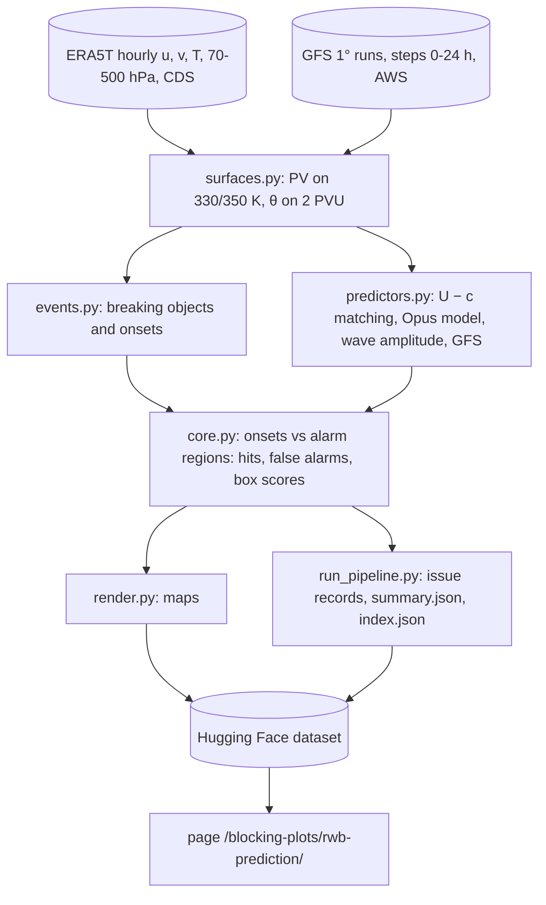

# Rossby wave breaking prediction check

Runs once a day on GitHub Actions (`.github/workflows/rwb_prediction.yml`) and publishes to the public Hugging Face
dataset `yanxingjianken/rwb-prediction`, which the page `/blocking-plots/rwb-prediction/` reads.

**Question.** Can new Rossby wave breaking be predicted a day ahead from the analysed flow alone, without running a
weather forecast? At every 00 and 12 UTC issue time four methods mark alarm regions on the map, on three upper-level
surfaces (PV on 330 K, PV on 350 K, θ on 2 PVU):

- **U − c matching**: on contours at fixed equivalent latitudes, every 15° of longitude, the phase speed c of the
  contour's undulation over the past 24 h against the wind U along it; the region lies within 500 km of the pieces
  where |U − c| ≤ 2 m s⁻¹.
- **Opus model**: a predictor variable computed from the analysed winds and θ on 2 PVU of the past 60 h in local
  cells; the region covers the cells where it has fallen to 0.1 of its value 1.5–2.5 days earlier. One set of alarm
  regions per issue time, scored against the breakings of all three surfaces.
- **Wave amplitude (no forecast)**: from θ on 2 PVU at the issue time alone (smoothed as for the events), each
  point's displacement from the equivalent latitude of its value (the latitude of the circle round the pole enclosing
  the same area); the region covers the points where the rms displacement over 3° of latitude × 15° of longitude
  reaches 8.5°. The threshold is the best box skill on θ on 2 PVU over the issue times 2026-09-30 12 UTC to
  2026-10-26 12 UTC (`AMP_FIT_LAST_ISSUE`); later issue times are out of sample. One set of alarm regions per issue
  time, scored against the breakings of all three surfaces.
- **GFS 24-h forecast**: the NOAA GFS run from the issue time; the region lies within 500 km of the new breakings it
  forecasts at 6–24 h.

**Truth.** ERA5T (about five days behind real time). Breaking objects every 6 h from overturning circumpolar contours
at fixed values (PV every 0.5 PVU, θ every 5 K; after the method of `pvtend.rwb`; field smoothed with a 3° Gaussian,
bays of at least 300 deg², anticyclonic or cyclonic by the path-order rule, merged within 1000 km); an onset is an
object with no object of the same type within 1500 km 6 h and 12 h earlier.

**Scores.** A new breaking within 24 h of the issue time is a hit when an alarm region lies within 1000 km of it; an
alarm region with no breaking within 1000 km is a false alarm; on about 210 equal-area boxes (≈1000 km) north of
10° N, the false positive rate is the share of the boxes without a breaking that an alarm region touched.

All settings are in `config.py` and were fixed before any score was computed, except the wave-amplitude threshold
(chosen on October 2026, as above).

| File | Content |
| --- | --- |
| `config.py` | every setting |
| `era5.py`, `gfs.py` | ERA5T from the Climate Data Store; GFS 1° by byte ranges from the NOAA Open Data bucket |
| `surfaces.py` | Ertel PV from pressure levels; PV on isentropes, θ on 2 PVU (same code for both sources) |
| `events.py` | breaking objects, types, flanks, onsets |
| `predictors.py` | the four methods' alarm regions |
| `core.py` | one issue time: onsets of the next 24 h, alarm regions, hits, false alarms, box scores |
| `render.py` | the maps |
| `run_pipeline.py` | daily mode (Actions) and a one-off backfill mode |
| `tests/` | breaking types on an idealized jet; contour crossings; wave amplitude of symmetric and displaced fields |

Local backfill (run once by hand; nothing recurring):

    python run_pipeline.py --backfill 2026093012 2026102612 --era5-dir era5 --out out --workers 8

The daily job needs the repository secrets `HF_TOKEN` and a personal access token of the ECMWF data stores (`CDSAPI_KEY` or `ECDS_API`; the token itself or the text of an API configuration file, any data-store URL — ERA5 is always requested from the Climate Data Store).
